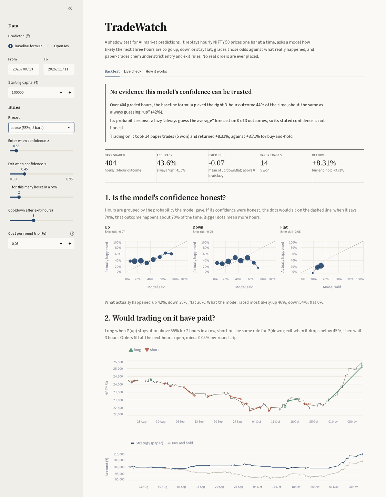

# TradeWatch

A shadow-testing harness for AI market predictions. It replays hourly NIFTY 50 prices one bar at a time, asks a model for the probability that the next three hours go up, down or stay flat, grades those probabilities against what really happened, and paper-trades them under a strict entry/exit state machine. It never places a real order.

The question it answers: **can this model's confidence be trusted, and would acting on it have paid off?**



**Live demo:** _add your Streamlit link here_ · **Write-up:** [REPORT.md](REPORT.md)

## Result so far

Neither predictor's confidence can be trusted yet.

- **OpenJev**, on 89 graded hours (17 Sep – 7 Oct 2026): 39.3% accuracy, below the 41.6% you get by always guessing "down". It scored worse than a lazy average forecast on all three outcomes (Brier skill −0.17, −0.33, −0.42).
- **Baseline formula**, on 411 graded hours (Aug – Nov 2026): 42.3% accuracy, against 41.1% for always guessing "up". It was also worse than lazy on all three outcomes.

At strict settings, the filter correctly declined to trade the baseline at all. Details are in [REPORT.md](REPORT.md).

## How it works

1. **Prices.** Hourly NIFTY 50 bars come from Yahoo Finance (`data.py`). The app falls back to a bundled one-year sample if Yahoo is unreachable.
2. **Features, past only** (`features.py`). These are the 1h, 5h and 20h returns, 20-hour volatility, and the price versus its 20-hour average. The text sent to the model contains **no date and no index name**, so a language model cannot recall what happened next.
3. **Predictor** (`predictor.py`). There are two choices:
   - `baseline`: a one-line trend formula. It is free and needs no key.
   - `jev`: OpenJev via `api.codiv.ai`. Answers are cached on disk, keyed by the exact prompt text.
4. **Grading** (`calibration.py`). Labels say what really happened over the next 3 bars: up or down by more than 0.1%, otherwise flat. The report covers:
   - accuracy, set against the real class frequencies and the "always guess the most common outcome" accuracy;
   - the Brier score for each class, and Brier skill against a lazy forecaster that always predicts the average;
   - reliability tables showing whether "70% sure" comes true about 70% of the time.
5. **Entry/exit state machine** (`signals.py`). Long positions watch P(up) and shorts watch P(down). There are three rules:
   - **Persistence:** the probability must stay at or above the entry line for N bars in a row.
   - **Hysteresis:** exit only when it falls below a lower exit line.
   - **Cooldown:** rest for some bars after each exit.
6. **Execution** (`signals.Runner`). A decision on bar *t* uses bar *t*'s close, so the order fills at **bar t+1's open**. A signal on the very last bar stays pending.
7. **Money** (`trades.py`). Each trade's return has a round-trip cost deducted, and the account compounds in rupees.

Backtest and live poll drive the **same `Runner` code** (`pipeline.replay`). A test checks that running in chunks, saving and restoring state in between, gives exactly the same trades as one continuous run.

## Setup

```bash
git clone https://github.com/<your-username>/tradewatch.git
cd tradewatch
python -m venv venv
source venv/bin/activate          # Windows: venv\Scripts\activate
pip install -r requirements.txt
```

To use OpenJev (optional; this spends free-tier API tokens):

```bash
export TYPESAFE_BASE_URL="https://api.codiv.ai"
export TYPESAFE_API_KEY="sk-codiv-..."      # never commit this
```

## Usage

```bash
# Backtest with the free baseline predictor (end date is exclusive)
python cli.py analyze --start 2026-08-11 --end 2026-11-11

# Loosen the rules to see the mechanics trade; change the cost; get JSON
python cli.py analyze --start 2026-08-11 --end 2026-11-11 --entry 0.55 --persist 2 --exit 0.45
python cli.py analyze --start 2026-08-11 --end 2026-11-11 --cost 0.001 --json

# OpenJev on the window whose answers are bundled (no API calls)
python cli.py analyze --start 2026-09-14 --end 2026-10-08 --predictor jev

# Strict / Medium / Loose presets side by side against buy-and-hold
python compare.py 2026-08-11 2026-11-11 baseline
python compare.py 2026-09-14 2026-10-08 baseline jev

# Live check: processes only new, finished hourly bars; state kept in state.json
python cli.py poll

# Dashboard
streamlit run app.py

# Tests (no network needed)
pytest
```

## Deploying on Streamlit Community Cloud

1. Push the repo to GitHub. `venv/`, `state.json`, `jev_cache.json` and `.streamlit/secrets.toml` are git-ignored.
2. On [share.streamlit.io](https://share.streamlit.io), create a new app. Pick the repo, branch `main` and main file `app.py`. Under *Advanced settings*, choose Python 3.10 or newer.
3. **Secrets are optional.** Without a key, the public app runs the baseline formula, and OpenJev results come from the bundled window, so nobody can spend your tokens. To allow new OpenJev calls, add these under *Settings → Secrets*:
   ```toml
   TYPESAFE_API_KEY = "sk-codiv-..."
   TYPESAFE_BASE_URL = "https://api.codiv.ai"
   JEV_PASSCODE = "something-only-you-know"   # new calls require this passcode
   ```

## Project layout

```
config.py       settings: ticker, horizon (3 bars), flat band (0.1%), API URL
data.py         Yahoo download, bundled-sample fallback, drop unfinished bars
features.py     past-only features + the anonymous text sent to the model
predictor.py    baseline formula and OpenJev client with prompt-keyed cache
calibration.py  labels, accuracy vs. majority class, Brier score and skill
signals.py      Cfg, Machine (persistence/hysteresis/cooldown), Runner (next-bar-open fills)
trades.py       per-trade return (long and short) and compounding
pipeline.py     backtest, live poll, summary, equity curve (one shared replay loop)
cli.py          command line (analyze / poll, --json)
compare.py      Strict / Medium / Loose vs. buy-and-hold
app.py          Streamlit dashboard
tests/          offline pytest suite
sample_data/    one year of NIFTY hourly bars + post-fix OpenJev answers
```

## Limitations

- **Fills.** Orders fill at the next bar's open, with one flat cost per round trip (default 0.05%). Real orders also face spread and slippage that vary.
- **Overnight gaps.** NIFTY trades 9:15–15:30, and the last hourly bar is only 15 minutes long. Near the close, a "3-bar" horizon spans the overnight gap, and a signal on the last bar fills at the next morning's open.
- **The index is not tradable directly.** P&L assumes a hypothetical instrument that tracks NIFTY 50 exactly and can be shorted freely.
- **One account.** Long and short trades compound in a single chain, ordered by exit time, as if the whole account backs each trade.
- **Small samples.** A few hundred hours and a handful of trades are a demonstration, not statistical proof. One lucky trade can dominate the result; see the report.
- **Data depth.** Yahoo only provides about 730 days of hourly data.
- **OpenJev is not TypeSafe's Jev.** It is an independent open-source server that copies Jev's API, so results here are not a verdict on the original model.
- **Pre-fix results.** An earlier version (before these fixes) sent the date and index name to the model and used a wrong short-return formula. Those early Jev numbers are kept in the report for transparency, but they are not comparable.
- **No hosted API.** The brief mentions a JSON API underneath the interfaces. Here that is `pipeline.summarize()` and `cli.py --json`; no web server was built, on purpose.
- **Live mode** is manual on purpose, with no scheduler. On the dashboard, live state lasts only for the browser session.
